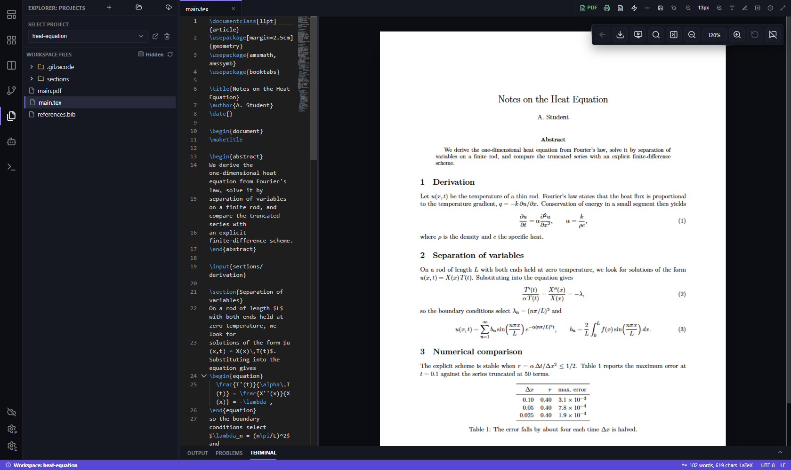
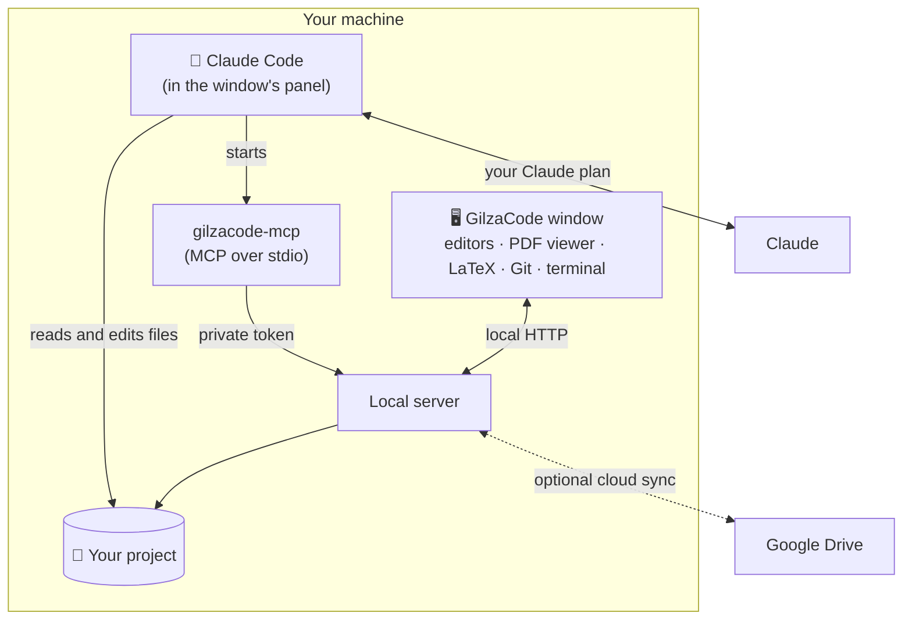
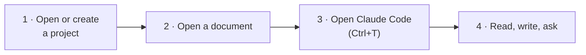
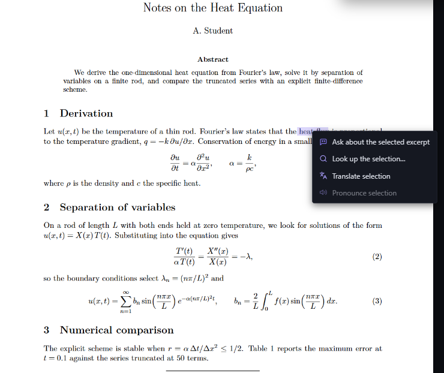

<p align="center">
  
</p>

<h1 align="center">GilzaCode</h1>

<p align="center">
  <strong>A desktop workspace for reading and writing, with Claude Code as its assistant.</strong><br>
  Read PDFs with AI help, write LaTeX with a live PDF preview, edit Markdown and rich text,<br>
  and let Claude Code see and drive the window you are working in.
</p>

<p align="center">
  
  
  
  
</p>

<p align="center">
  <a href="#-install">Install</a> ·
  <a href="#-quick-start">Quick start</a> ·
  <a href="#-features">Features</a> ·
  <a href="#-claude-code-inside-the-window">Claude Code</a> ·
  <a href="#%EF%B8%8F-cloud-sync">Cloud sync</a> ·
  <a href="#%EF%B8%8F-development">Development</a>
</p>

<p align="center">
  
  <br>
  <sub>A LaTeX project: the source in the editor, the compiled PDF beside it, SyncTeX between the two.</sub>
</p>

> [!NOTE]
> **Free, with no account and no subscription.** The only thing GilzaCode needs besides Windows or Linux is
> [Claude Code](https://code.claude.com). GilzaCode itself calls no model: the conversation belongs
> to Claude Code, under your own Claude plan.

---

## Contents

- [Features](#-features)
- [How it works](#-how-it-works)
- [Install](#-install)
- [Quick start](#-quick-start)
- [Reading PDFs](#-reading-pdfs)
- [Claude Code inside the window](#-claude-code-inside-the-window)
- [Cloud sync](#%EF%B8%8F-cloud-sync)
- [Uninstall](#%EF%B8%8F-uninstall)
- [Feedback and bug reports](#-feedback-and-bug-reports)
- [Development](#%EF%B8%8F-development)
- [Support](#-support)

---

## ✨ Features

<table>
  <tr>
    <td width="50%" valign="top">
      <h3>🤖 Claude Code built in</h3>
      Claude Code runs in its own panel, in the project you have open. Document actions hand it a prompt that you read and send yourself.
    </td>
    <td width="50%" valign="top">
      <h3>📖 AI-assisted reading</h3>
      Select text in a PDF and <b>Ask about</b> it, <b>Look it up</b>, <b>Translate</b> it or hear it <b>pronounced</b>. Highlight, annotate and present.
    </td>
  </tr>
  <tr>
    <td valign="top">
      <h3>📄 LaTeX built in</h3>
      Tectonic ships with the app: compile, preview, jump between source and PDF with SyncTeX, and recompile just the part you edited on save. Export to Word through pandoc.
    </td>
    <td valign="top">
      <h3>🔌 Claude sees your window</h3>
      An MCP server lets Claude Code read the open file and selection, the PDF page you are on and the compile errors, and open files, reveal a line in the PDF or compile for you.
    </td>
  </tr>
  <tr>
    <td valign="top">
      <h3>✍️ Editors for every format</h3>
      A code editor for sources, rich text and WYSIWYG editing, and Markdown with live preview and Mermaid diagrams.
    </td>
    <td valign="top">
      <h3>☁️ Cloud sync</h3>
      Keep a project mirrored in your Google Drive and continue it on another computer. Edits Claude Code makes on disk are synced too.
    </td>
  </tr>
  <tr>
    <td valign="top">
      <h3>🧑‍💻 A complete workspace</h3>
      Project explorer, Git, an integrated terminal, and four layouts: IDE, Chat, Studio and Document.
    </td>
    <td valign="top">
      <h3>🌐 Bilingual interface</h3>
      English and Brazilian Portuguese.
    </td>
  </tr>
</table>

---

## 🧭 How it works

GilzaCode is the window; Claude Code is the assistant. Claude Code runs in the window's panel and
starts GilzaCode's MCP bridge, which talks to the window over a private local connection.



The architecture and design decisions are documented in [PROJECT_DESIGN.md](PROJECT_DESIGN.md).

---

## 📦 Install

### Requirements

- **Windows 11.** The WebView2 Runtime and .NET Framework that the window needs ship with it.
- **Or Linux: Ubuntu 22.04 or newer, x86_64.** The window's browser engine (QtWebEngine) ships inside the package.
- **[Claude Code](https://code.claude.com)**, with `claude` on your `PATH`. The installer warns if it is missing.

### Windows

Open PowerShell and run:

```powershell
irm https://raw.githubusercontent.com/gilzamir18/GilzaCode/HEAD/install.ps1 | iex
```

<details>
<summary>Prefer to inspect the script first?</summary>

```powershell
Invoke-WebRequest https://raw.githubusercontent.com/gilzamir18/GilzaCode/HEAD/install.ps1 -OutFile install.ps1
Get-Content .\install.ps1
.\install.ps1
```

</details>

<details>
<summary>Installing a package you built or downloaded</summary>

```powershell
powershell -ExecutionPolicy Bypass -File install.ps1 -Source dist\GilzaCode-windows-x64.zip
```

</details>

The installer downloads the latest release and installs it **for your user only** into
`%LOCALAPPDATA%\GilzaCode`, with no administrator rights. It creates shortcuts on the Desktop and in
the Start menu, and an entry in **Settings › Apps › Installed apps**.

### Linux

Open a terminal and run:

```bash
curl -fsSL https://raw.githubusercontent.com/gilzamir18/GilzaCode/HEAD/install.sh | bash
```

<details>
<summary>Installing a package you built or downloaded</summary>

```bash
bash install.sh --source dist/GilzaCode-linux-x64.tar.gz
```

</details>

The installer installs the latest release **for your user only** into `~/.local/share/GilzaCode`,
with no administrator rights, and adds GilzaCode to the application menu. It does not run as root:
the window's browser engine refuses to.

---

## 🚀 Quick start



1. **Open or create a project.** A project is a folder on your disk. Use the **+** (new project) or the folder (open existing) button in the explorer.
2. **Open a document**: a PDF to read, a `.tex` file to write (the PDF preview opens beside it), or Markdown.
3. **Open Claude Code** with **Ctrl+T** or the robot button. The first time in a folder, Claude Code asks whether you trust it; answer in the panel.
4. **Work.** Select text and right-click for the reading actions, or ask Claude Code directly. When an action prepares a prompt for Claude Code, it is pasted into the panel **unsent**: you read it, edit it, and press Enter yourself.

---

## 📖 Reading PDFs

<p align="center">
  
</p>

| Action | What it does |
|--------|--------------|
| **Ask about** | Prepares a question about the selection, with its page and document, for Claude Code. |
| **Look up** | Explains the selected term in a popup, through `claude -p`. |
| **Translate** | Translates the selection in a popup, through `claude -p`. |
| **Pronounce** | Reads the selection aloud with a local voice. |
| **Highlights and notes** | On standalone PDFs (a paper, a reference), marks are written into the PDF itself, so highlights from Zotero or Acrobat show up here and yours travel with the file. |
| **Present** | Full-screen presentation mode for slides. |

---

## 🤖 Claude Code inside the window

Claude Code runs in the panel exactly as in a terminal, with its own sessions, settings and
`/resume`. GilzaCode adds an MCP server so that Claude Code can work with the window, not just with
the files:

| Tool | What Claude Code can do |
|------|-------------------------|
| `get_editor_state` | See the open files, the current one, the selection and unsaved changes |
| `get_pdf_view` | See which PDF and page you are reading, and what you selected |
| `open_file` / `close_file` | Open a file in the editor, at a line, or close it |
| `reveal_in_pdf` | Show where a `.tex` line lands in the compiled PDF |
| `set_layout` | Switch between the IDE, Chat, Studio and Document layouts |
| `get_problems` | Read the compile errors and warnings |
| `compile_latex` | Compile a `.tex` file |
| `list_pdf_annotations` | Read the highlights and notes in a PDF |

The tools that only read or show something are allowed in advance; `compile_latex` asks for your
permission.

---

## ☁️ Cloud sync

Each project can be mirrored to **Google Drive** and continued on another computer.

- **Connect once.** Open the cloud button in the activity bar and press **Connect**: Google opens in your browser. GilzaCode can only see the folder it creates for your projects, not the rest of your Drive.
- **It keeps up by itself.** Saves from the editor sync after a short pause, and so do the edits Claude Code makes directly on disk.
- **Another computer.** Use the download button in the explorer to bring a mirrored project down and keep working on it there.
- **Nothing is lost silently.** When both sides changed the same file, both versions are kept and you choose; a pass that would delete many files asks first.

`.env` files (unless you opt in) and the sync's own bookkeeping never leave your machine.

---

## 🗑️ Uninstall

Use **Settings › Apps › Installed apps › GilzaCode**, or **Uninstall GilzaCode** in the Start menu.
On Linux, run `bash ~/.local/share/GilzaCode/GilzaCode/_internal/uninstall.sh` (the installer prints it).

Your settings and project list in `~/.gilzacode` are kept unless you run the uninstaller with
`-Purge` (Linux: `--purge`), which asks for confirmation. **Project folders are never removed.**

---

## 💬 Feedback and bug reports

Suggestions and bug reports are welcome at the
[GilzaCode issue tracker](https://github.com/gilzamir18/GilzaCode/issues). Please remove private
information (paths, document contents) before posting.

---

## 🛠️ Development

Requirements: **Python 3.12 or newer**, **Node.js/npm** and **Git**.

```powershell
git clone https://github.com/gilzamir18/GilzaCode.git
cd GilzaCode
python -m venv .venv
.venv\Scripts\python.exe -m pip install -e .[dev]
cd gui; npm ci; npm run build; cd ..     # builds the interface into gilzacode/static
.venv\Scripts\python.exe -m gilzacode
```

### Build and test

```powershell
.venv\Scripts\python.exe -m pytest                      # backend
cd gui; npm run test:wysiwyg; npx eslint src; cd ..     # interface

# Windows package: dist\GilzaCode\ and dist\GilzaCode-windows-x64.zip
powershell -ExecutionPolicy Bypass -File build_exe.ps1
```

```bash
# Linux package: dist/GilzaCode/ and dist/GilzaCode-linux-x64.tar.gz (see the header of
# build_exe.sh for the libraries the build machine needs; build on Ubuntu 22.04)
bash build_exe.sh
# open the real window and check it (needs a display, or xvfb-run)
python3 scripts/smoke_linux_window.py -- ~/.local/share/GilzaCode/GilzaCode/GilzaCode
```

To ship Google Drive sync ready to use, set `GILZACODE_GDRIVE_CLIENT_ID` and
`GILZACODE_GDRIVE_CLIENT_SECRET` (a "Desktop app" OAuth client) before running `build_exe.ps1`, or
embed the client once with `python scripts\embed_google_client.py --from-file client_secret_….json`.
The embedded file is git-ignored.

Releases are built by GitHub Actions ([release.yml](.github/workflows/release.yml)): set the same
version in `pyproject.toml` and `gilzacode/__init__.py`, then push a tag `v<version>`. The workflow
tests, builds and attaches `GilzaCode-windows-x64.zip` to the release. It builds the Linux package
in an Ubuntu 22.04 container, installs it on Ubuntu 22.04, 24.04, 26.04 and the latest release and
checks the window on each, then attaches `GilzaCode-linux-x64.tar.gz`.

Set `GILZACODE_DEVTOOLS=1` to open the window with developer tools, and `GILZACODE_HOME` to use a
data folder other than `~\.gilzacode`.

### Project layout

| Path | Contents |
|------|----------|
| `gilzacode/` | The window, the local server, the LaTeX, PDF, Git and terminal backends, the MCP bridge |
| `gilzacode/cloud/` | Cloud sync: engine, scanner, providers |
| `gui/` | The interface (React and Vite) |
| `packaging/`, `build_exe.ps1`, `build_exe.sh` | The Windows and Linux builds |
| `install.ps1`, `uninstall.ps1`, `install.sh`, `uninstall.sh` | Per-user installers and uninstallers |
| `tests/` | Backend tests |

---

## 💜 Support

GilzaCode is free. If it is useful to you and you would like to support its maintenance,
**Settings › About** has a donation link. Donations are voluntary and do not unlock any feature.
